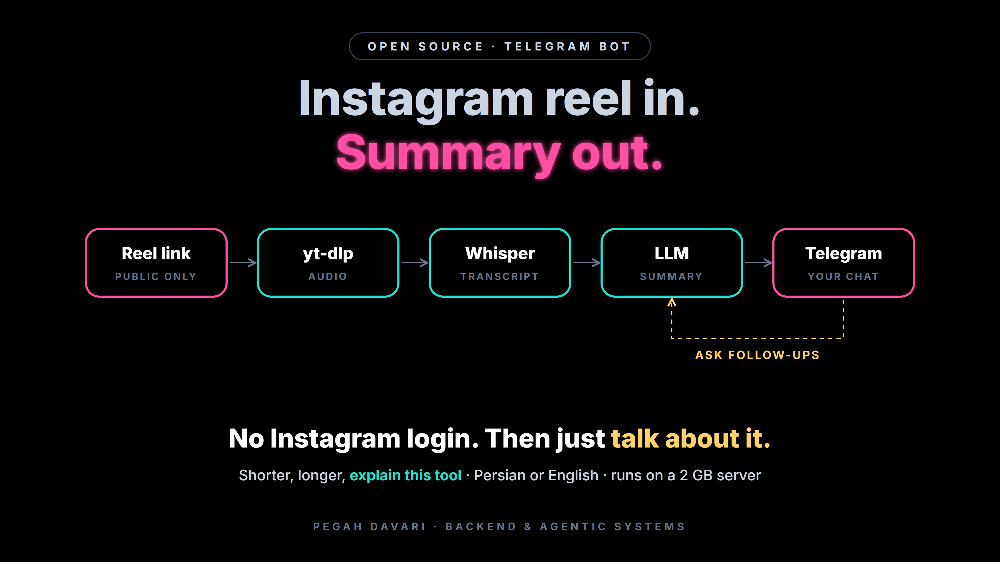

<p align="center">
  
</p>

# reel-bot

A small Telegram bot that turns an Instagram reel link into a written summary.
Send it a public reel link, get back the key points, claims and tools mentioned.

**Flow:** reel link → `yt-dlp` (audio only) → `ffmpeg` → Whisper API (transcript) → LLM (summary) → Telegram message

## Features

- Public reels only. It **never logs in to Instagram**, so your account is not at risk.
- Summaries in Persian (`fa`) or English (`en`), switch with `/lang fa` or `/lang en`.
- Follow-up chat: after a summary, just type ("shorter", "explain more", "what is this tool?", "write a LinkedIn post") and it answers from the reel's full transcript. A new link starts a new conversation.
- Locked to a single Telegram user ID, so nobody else can spend your API keys.
- Transcription and summaries run through OpenAI-compatible APIs (default: Groq Whisper + GapGPT/Gemini; any provider works), so it is light enough for a 2 GB server shared with other services.
- Caches repeated links, deletes temporary files after each job, and shows clear errors (private reel, blocked IP, empty audio, rate limits).
- Telegram long polling: no domain, webhook or open port needed.

## Setup

```bash
# on the server (Debian/Ubuntu)
adduser --disabled-password --gecos "" reelbot
apt update && apt install -y ffmpeg python3-venv

git clone https://github.com/callipegah/reel-bot.git /home/reelbot/reel-bot
mkdir -p /home/reelbot/reel-bot/data
chown -R reelbot:reelbot /home/reelbot/reel-bot
sudo -u reelbot bash -c 'cd ~/reel-bot && python3 -m venv venv && venv/bin/pip install -r requirements.txt'

sudo -u reelbot bash -c 'cd ~/reel-bot && cp .env.example .env && chmod 600 .env'
nano /home/reelbot/reel-bot/.env     # add the three keys

cp /home/reelbot/reel-bot/reel-bot.service /etc/systemd/system/
systemctl daemon-reload && systemctl enable --now reel-bot
journalctl -u reel-bot -f
```

You need a Telegram bot token ([@BotFather](https://t.me/BotFather)), a speech-to-text key ([Groq](https://console.groq.com) free tier, or GapGPT) and an LLM key ([GapGPT](https://gapgpt.app), or any OpenAI-compatible provider). Provider, base URL and model are set in `.env` (see `.env.example`).

### Lock it to yourself

Leave `ALLOWED_USER_ID` empty on the first run. The bot starts in setup mode and only answers `/id`. Send `/id`, put the number in `.env`, then `systemctl restart reel-bot`.

### Keep yt-dlp fresh

Instagram changes often. If downloads suddenly fail:

```bash
sudo -u reelbot /home/reelbot/reel-bot/venv/bin/pip install -U yt-dlp && systemctl restart reel-bot
```

## Tests

```bash
python test_bot.py
```

The network parts (yt-dlp, speech-to-text, LLM, Telegram) are mocked.

## Security

- Keys live only in `.env` (mode 600), which is git-ignored. Never commit it.
- The systemd unit runs as its own user with a read-only home and a memory/CPU cap.

---

# ربات خلاصه‌ی ریل (فارسی)

یک ربات تلگرام که لینک ریل اینستاگرام را می‌گیرد، صدای آن را به متن تبدیل می‌کند و خلاصه‌ی فارسی یا انگلیسی می‌فرستد.

- فقط ریل‌های عمومی. هیچ لاگینی به اینستاگرام انجام نمی‌شود.
- فقط به user ID خودتان جواب می‌دهد.
- رونویسی (Whisper) و خلاصه‌سازی با APIهای سازگار با OpenAI (مثلاً GapGPT یا Groq)؛ روی سرور فقط یک اسکریپت سبک اجرا می‌شود.
- راه‌اندازی: مراحل بالا را اجرا کنید، کلیدها را در `.env` بگذارید، یک بار `/id` بفرستید و عدد را در `ALLOWED_USER_ID` بنویسید.
